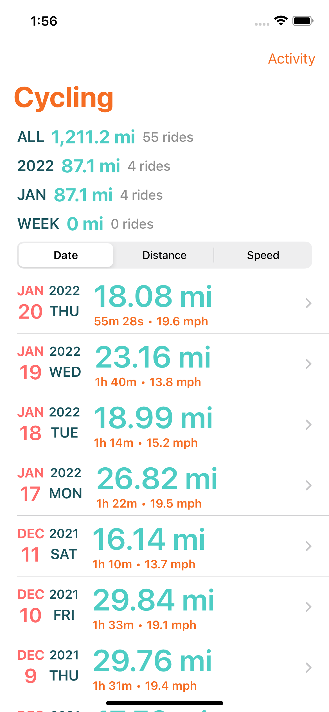

# BikeLog
### A playground for HealthKit workout data

BikeLog is an open source app exploring modern app development through the lens of displaying workout data from HealthKit.

Tap **All** above the workout log to see the selected activity's all-time mileage and workout count in the **Total** row above the yearly breakdown. Tap a year for monthly totals, then tap a month to see its workouts.
The current year, month, and week summaries also open their corresponding breakdown or filtered workout list directly.

Open a workout for its route, heart rate, active calories, and elevation gain when recorded. **Speed by Mile** uses elapsed time, including stops, and shows one point per completed mile when timed distance data is available.

## Requirements

- iOS 26.6 or later

## Development Concepts
### Frameworks
- SwiftUI
- Observation
- Async/Await
- Measurement API
- iOS 15 `formatted` API

### Implementation Callouts
- Protocol based data provider `HealthProvider` to allow for mock providers that do not require HealthKit.
- Composable SwiftUI views with `#Preview` and mock workout data.
- `UserDefaults` for the selected activity preference.
- An async HealthKit query scoped to the selected activity, cancelled when the selection changes or the log disappears. A full query replaces the cached snapshot; anchored updates merge changes.
- Workout snapshots and query anchors are saved together in a protected, rebuildable cache outside Documents.
- A main-actor `@Observable` manager exposes workout updates to SwiftUI.
- Workout distance comes from HealthKit statistics when available, with a fallback for older workouts.
- Summaries share distance conversion and aggregation; the main header uses the preferred unit and the breakdowns show miles.
- The breakdown and filtered workout screens share loading, empty, and retry states. A failed refresh leaves previously loaded workouts visible.
- Extending the Measurement API to create custom units to represent "pace" based speed.
- Unit Testing.

